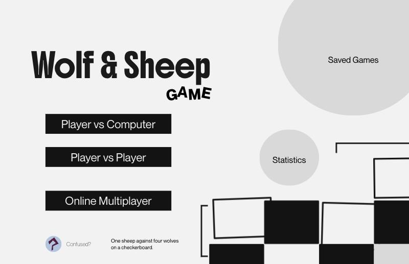
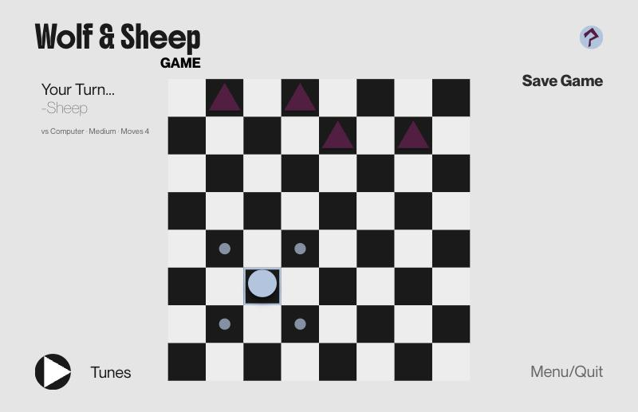

# Wolf & Sheep

[](https://github.com/rafaelahenriques/Wolf-and-Sheep-Game-main/actions/workflows/ci.yml)
[](https://wolfandsheepgame.netlify.app)

A turn-based strategy board game with a computer opponent, a REST API and a React web client. It began as a 2021 university group project in Python and Pygame, and in 2026 I rebuilt it on my own as a full-stack app.

**[Play it in the browser](https://wolfandsheepgame.netlify.app)** · [Case study](https://rafaelahenriques.com/projects/wolf-sheep/) · [Original 2021 version](https://github.com/rafaelahenriques/Wolf-and-Sheep-Game)



> The API runs on a free hosting plan that sleeps when idle, so the first request can take about a minute while the server wakes up.

## Highlights

- **One engine for every interface.** The game rules live in a pure-Python `engine/` package with no UI code. The Pygame desktop game, the FastAPI backend and the test suite all use the same engine.
- **Computer opponent.** Easy plays random legal moves. Medium and Hard use minimax with alpha-beta pruning, looking one and six moves ahead.
- **REST API.** FastAPI endpoints for games, moves, saves and statistics, with interactive documentation at `/docs`.
- **Persistence.** Saved games and statistics are stored in PostgreSQL through SQLAlchemy, and Alembic migrations manage schema changes.
- **Typed web client.** The client uses React, TypeScript and Vite, and respects reduced-motion settings.
- **Tested in CI.** 33 pytest tests cover the engine, AI, API, database and saves. GitHub Actions runs them on every push, along with a lint and build of the web client.

## Tech stack

Python 3.12 · FastAPI · PostgreSQL · SQLAlchemy · Alembic · pytest · React · TypeScript · Vite. The API is deployed on Render and the web client on Netlify.

---

## Table of Contents

1. [Project Overview](#1-project-overview)
   - 1.1 Game Rules
   - 1.2 Player Controls
   - 1.3 Game Modes
2. [Main Menu](#2-main-menu)
3. [Game Board](#3-game-board)
4. [Playing Against the Computer](#4-playing-against-the-computer)
5. [Project Structure](#5-project-structure)
6. [Running Locally](#6-running-locally)
7. [Deployment](#7-deployment)
8. [Credits and History](#8-credits-and-history)

---

### 1. Project Overview

Wolf & Sheep is a two-player strategy game played on an 8×8 board. One player controls **one sheep**, while the other controls **four wolves**.

The game can be played in a browser, either against the computer or another player on the same device. The original desktop version, developed with pygame, remains part of the project.



#### 1.1 Game Rules

Players take turns moving one piece diagonally by one square. The sheep moves first.

**The sheep wins by:**
- Reaching the top row of the board.

**The wolves win by:**
- Trapping the sheep so that it has no legal moves remaining.

If a player has no legal moves when their turn begins, they lose.

#### 1.2 Player Controls

The game is controlled using a mouse or touchscreen.

- Click or tap a piece to select it. Available moves are highlighted.
- Click or tap a highlighted square to move the selected piece.
- Click or tap the selected piece again to cancel the selection.

**Wolf Movement**
- Wolves can only move diagonally downwards.

**Sheep Movement**
- The sheep can move diagonally upwards or downwards.

#### 1.3 Game Modes

- **Player vs Computer:** The player controls the sheep while the computer controls the wolves. Three difficulty levels are available (see Section 5).
- **Player vs Player:** Two players take turns on the same device.
- **Online Multiplayer:** Not yet available.

### 2. Main Menu

The interface was designed in Figma and implemented using React. Headings use the *Boldonse* typeface, while body text uses *Neue Montreal*, with *Inter Tight* as a fallback when Neue Montreal is unavailable.

**The main menu includes:**

- **Player vs Computer:** Select a difficulty level and start a game.
- **Player vs Player:** Start a local two-player game.
- **Online Multiplayer:** Coming soon.
- **Saved Games:** Resume a previously saved game.
- **Statistics:** View games played, win rate, average number of moves, and wins by difficulty level.
- **Confused?:** Open the game rules.

### 3. Game Board

**The game screen includes:**

- An 8×8 board centred on the screen, featuring the sheep (blue circle) and four wolves (purple triangles).
- Information about the current turn, game mode, difficulty level, and number of moves.
- **Save Game:** Save the current game to continue later.
- **Menu/Quit:** Return to the main menu.
- **Tunes:** Play a live radio station from a randomly selected country, displaying the country and station name through the [Radio Browser](https://www.radio-browser.info) service.
- **Game Over:** Display the winner alongside **Play Again** and **Menu** buttons.

Pieces slide between squares, and screen transitions are animated. These animations are disabled when the user's system has reduced-motion preferences enabled.

### 4. Playing Against the Computer

The computer controls the wolves. Its logic is implemented in `ai/players.py`.

Three difficulty levels are available:

- **Easy:** Wolves make random legal moves.
- **Medium:** Wolves evaluate one move ahead.
- **Hard:** Wolves search six moves ahead.

The Medium and Hard difficulties use the **minimax algorithm with alpha-beta pruning**.

Each board position is evaluated based on the number of moves the sheep needs to reach the top row and how many wolves remain between the sheep and its destination.

### 5. Project Structure

| Directory / File | Description |
|---|---|
| `engine/` | Game rules, state management, legal moves, and winner detection |
| `ai/` | Computer opponent logic |
| `api/` | FastAPI backend used by the web application |
| `storage/` | PostgreSQL database (SQLAlchemy) and saved games in `saves/` |
| `migrations/` | Database migrations managed with Alembic |
| `web/` | Web application built with React, TypeScript, and Vite |
| `tests/` | Automated tests using pytest |
| `main.py`, `game.py` | Original desktop version built with pygame |

**API Endpoints**

- `POST /games` — Starts a new game.
- `POST /games/{id}/moves` — Makes a move. Against the computer, the response also includes the wolves' move.
- `POST /games/{id}/save` — Saves a game.
- `GET /saves` — Retrieves saved games.
- `POST /saves/{name}/load` — Loads a saved game.
- `GET /stats` — Retrieves game statistics.
- `GET /health` — Checks whether the server is running.

When the API is running, interactive API documentation is available at `/docs`.

### 6. Running Locally

**Requirements:** Python 3.12, Node.js, and PostgreSQL.

#### API

```bash
python3.12 -m venv venv
source venv/bin/activate
pip install -r requirements.txt
createdb wolfsheep
alembic upgrade head
uvicorn api.main:app --reload
```

The API runs at `http://localhost:8000`.

By default, it connects to the `wolfsheep` PostgreSQL database on `localhost`. To use a different database, configure the `DATABASE_URL` environment variable.

#### Web Application

```bash
cd web
npm install
npm run dev
```

The application runs at `http://localhost:5173` and connects to the API at `http://localhost:8000`.

To configure a different API address, set `VITE_API_URL` in `web/.env`.

#### Desktop Version (pygame)

```bash
python main.py
```

The desktop version uses the same database for statistics.

#### Tests

```bash
createdb wolfsheep_test
pytest
```

The same tests run on GitHub Actions for every push and pull request, together with a lint and production build of the web client (see `.github/workflows/ci.yml`).

### 7. Deployment

The API is hosted on Render, with its configuration defined in `render.yaml`.

**API Configuration**

- **Build command:** `pip install -r requirements-api.txt`
- **Start command:** `alembic upgrade head && uvicorn api.main:app --host 0.0.0.0 --port $PORT`
- **Python version:** Defined in `.python-version` (3.12.15).
- **Environment variables:**
  - `DATABASE_URL`: Connection string for the Render PostgreSQL database.
  - `FRONTEND_URL`: Frontend address used for CORS configuration. Multiple addresses can be provided, separated by commas.

The build installs only the API dependencies, excluding pygame.

Because the service was not created using a Render Blueprint, Render does not automatically apply the `render.yaml` configuration. The build and start commands must also be configured manually in the service settings.

**Frontend Deployment**

The frontend is built using `npm run build` inside the `web/` directory, with `VITE_API_URL` configured to point to the deployed API.

**Render Free Plan Limitations**

- **Server inactivity:** The API goes to sleep after 15 minutes without requests and can take approximately one minute to restart. The frontend sends a request to `/health` when opened to initiate the wake-up process earlier.
- **Database expiration:** The free PostgreSQL database expires 30 days after creation.
- **In-memory game state:** Active games are stored in the API's memory and are lost whenever the server restarts.

### 8. Credits and history

**Rafaela Henriques**

- Interface design (Figma)
- Web application development (React)
- API and game engine development
- Computer opponent AI
- Database implementation and deployment
- Original desktop version (pygame)

**Versions**

- **1.0 (July 2021):** Original desktop version built with Python and Pygame as a university group project. I was responsible for the board, the main game file, the menu and the overall code structure. See [the original repository](https://github.com/rafaelahenriques/Wolf-and-Sheep-Game).
- **2.0 (October 2026):** Independent rebuild with a shared engine, computer opponent, API, database and web client.
